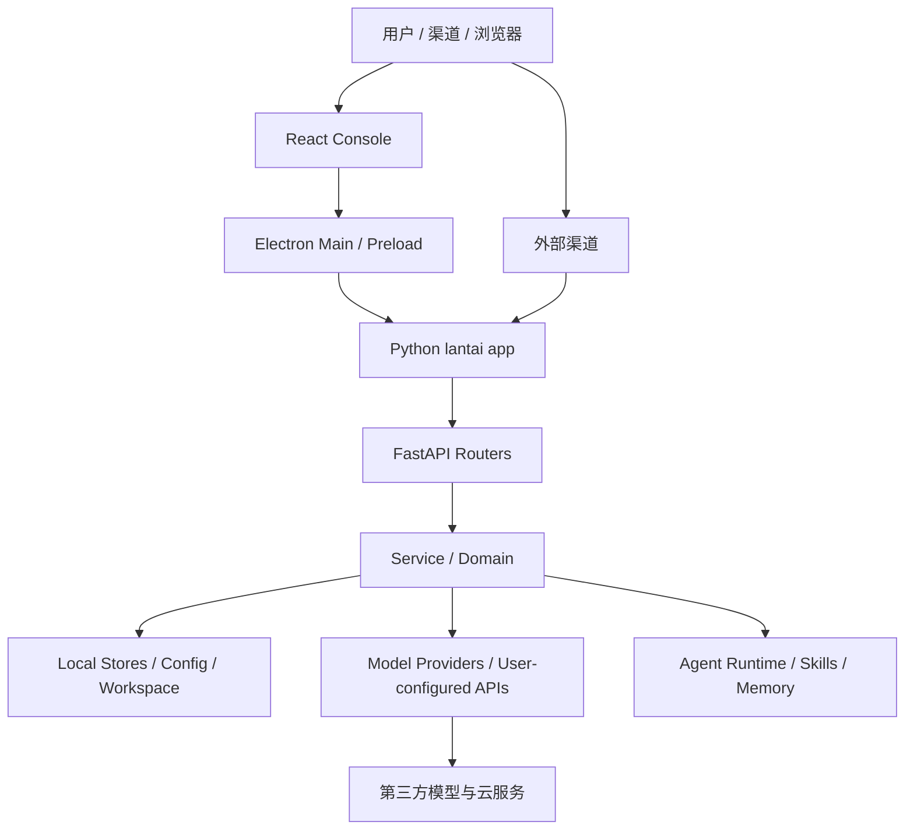

# 澜台 AI 编程助手架构导览

适用目录：`lantai3`  
发布目标：官网、GitHub Release、Developer ID、公证
最后更新：2026-08-14

这份文档给后续 AI 编程助手使用。目标不是把所有实现细节写完，而是让接手者在动手前先知道：代码在哪里、边界在哪里、哪些地方能安全动、哪些地方必须先补验证。

如果你只读一页，请读完本文再改代码。

---

## 1. 先读顺序

后续 AI 助手接手任务时，按这个顺序建立上下文：

1. 根目录 `../AGENTS.md`：官网单发行版最高优先级规则。
2. 当前版本 `README.md`：发布目标、构建入口、用户侧能力。
3. 本文：架构边界、重构守则、验证矩阵。
4. `docs/refactor-layering-plan-zh.md`：已识别的大文件和分层计划。
5. 如果任务涉及桌面入口，读 `docs/electron-main-architecture-zh.md`。
6. 具体任务涉及的代码、测试和构建脚本。

不要一上来就全仓库大改。澜台已经是产品代码库，不是实验脚手架。

---

## 2. 当前版本边界

`lantai3` 是面向官网和 GitHub Release 的桌面版本。

允许：

- GitHub Release 手动下载安装包；桌面端不包含自动更新能力。
- Developer ID 签名、公证和官网分发。
- 用户自配模型 Provider、官网侧活动和内部工具能力。
- 发布脚本生成 `dmg` / `zip` / release metadata。

### 2.1 单发行版决策

自 2026-07-27 起，Mac App Store / TestFlight 发行版停止维护。相邻目录
`../lantai_App Store` 仅保留为历史源码和发布证据归档，不再接收功能同步、修复、
测试、构建、签名或发布工作。

执行原则：

1. 新业务、修复、重构和文档只进入 `lantai3`。
2. 不再设计或维护 MAS 渠道 Adapter、沙盒降级、IAP、provisioning profile 或审核流程。
3. 历史文档中的双发行版记录是当时事实，不构成当前工作要求。
4. 官网版继续以 Developer ID、公证、DMG/ZIP 和 GitHub Release 为发布边界。

---

## 3. 顶层结构

```text
console/
  Electron 主进程、preload、React 控制台、前端构建配置

src/lantai/
  Python 应用主体，包括 CLI、FastAPI 路由、Agent、渠道、模型、技能、安全和工作区

scripts/
  安装、构建、打包、诊断脚本

deploy/
  Docker / 服务端部署入口

tests/
  unit / contract / integration 测试

docs/
  维护文档、分层计划、架构导览

release/
  本地打包产物，不能纳入源码管理
```

经验判断：当前项目不是失控代码库，但核心文件已经偏大。治理方向应是“拆薄入口 + 保留行为 + 增强测试”，不是重写。

---

## 4. 运行时结构



关键事实：

- 前端不是单独 SaaS 控制台，它依赖本地 Python 后端。
- Electron 主进程负责桌面生命周期、后端子进程、更新、IPC、窗口。
- Python 后端既服务桌面 UI，也服务渠道、任务、Agent 和本地运行环境。
- 很多问题发生在“桌面打包态”，不能只靠源码态判断。

---

## 5. 分层目标

后续重构按变化原因拆，而不是只按文件大小拆。

推荐层次：

```text
Entry
  React Page / Electron IPC / FastAPI Router / Channel Webhook

Schema / Contract
  TypeScript type / Pydantic model / response contract / event contract

Service
  用例编排：保存设置、执行导入、模型请求、任务调度

Domain
  纯规则：normalize、validate、filter、mapping、capability check

Adapter
  外部系统差异：OpenAI-compatible、DingTalk、Feishu

Store
  文件、JSON、配置、缓存、workspace、token store

Facade
  兼容旧 import 和旧调用路径，逐步迁移
```

一个模块拆完后，入口文件应该变薄，service 能读懂主流程，domain 函数可单测，adapter 只处理外部差异，store 不夹杂业务规则。

---

## 6. 当前高风险模块

下面这些模块不能“顺手大改”。必须先补行为锁，再逐步拆。

| 模块 | 主要文件 | 风险 | 原因 |
|---|---|---:|---|
| Electron 桌面生命周期 | `console/electron/main.cjs` | 中高 | IPC、更新、后端子进程、窗口、打包态行为 |
| Chat 前端 | `console/src/pages/Chat/index.tsx` | 高 | 发消息、stream、附件、技能、工具卡片高度耦合 |
| Workspace / Wiki | `src/lantai/app/routers/workspace.py` | 高 | 文件读写、知识库、导入、API response |
| Config | `src/lantai/config/config.py` | 高 | 默认值、迁移、落盘格式、环境变量 |
| Provider / Model | `src/lantai/providers/provider_manager.py` | 高 | stream、tool call、多 provider payload |
| Skills | `src/lantai/agents/skills_manager.py` | 高 | manifest、导入、扫描、安全、环境变量 |
| Runtime Kernel / Agent Loop | `src/lantai/runtime/**`、`src/lantai/app/runner/runner.py`、`src/lantai/agents/legacy_lantai_agent.py` | 最高 | Native turn loop、fallback、上下文、工具调用、记忆 |
| Channels | `src/lantai/app/channels/**` | 高 | 平台 webhook、媒体、异步生命周期 |

低风险优先级：

1. 文档和测试补齐。
2. 前端样式模块分层。
3. 单页面内的小组件提取。
4. 纯函数提取，不改输入输出。
5. router 内部 service 化，保留路由路径和响应结构。

---

## 7. 行为锁规则

任何治理或重构前，先判断会影响哪类行为，并选择最小验证集。

| 改动类型 | 必须验证 |
|---|---|
| 前端页面 / 组件 | `cd console && npm run build`，关键页面截图或手工 smoke |
| API router | 对应 unit / integration test，必要时 response snapshot |
| 配置 / store | load-save-load round trip，旧配置兼容 |
| Provider / model payload | request payload snapshot，stream/tool call 测试 |
| Channel | webhook fixture replay 或 contract test |
| Electron main / preload | 前端 build、main/preload 语法检查、桌面启动 smoke |
| 打包 / 更新 | 本地包验证、更新 metadata、签名/公证相关检查 |
| Agent / Memory / Skills | 原有 unit tests，至少一条真实聊天 smoke |

### 7.1 记忆链路的行为底线

涉及记忆捕获时，除单元测试外必须验证 Native 和 Legacy 两个回复后入口，并至少用一条
真实模型 smoke 同时覆盖：辅助模型优先、主模型兜底、用户核心自述、用户提供材料、
来源追溯和时效性理解。可见回复必须先完成，语义整理在受生命周期管理的后台任务中
继续；关闭时需排空已接收任务。模型未返回可解析的语义结果时只能保留原始证据，不得
将正则或机械切句直接晋升为长期记忆。

### 7.2 轮次意图的智力归属

“用户这轮是闲聊、要对话内回答，还是要澜台操作工作区/外部系统”是语义判断，必须由模型结合对话上下文决定，不得用关键词、文本长度、标题格式或其他本地启发式替代。

标准 Runner 不在 Native / Legacy 主运行轮前调用 provider 辅助模型。当轮可见主模型是意图、工具选择和完成判断的唯一语义所有者；Runtime 在同一真实运行轮中注入完成契约，并确定性实施工具 schema、参数、权限、安全、幂等、执行预算、产物验证和产品协议。辅助模型只能在正文终态后处理自动标题、记忆、作品识别、摘要、上下文预处理和答后反思；其开启、关闭、超时或换模型都不得改变首 token、`tool_choice`、Thinking 投影或当轮交付。旧会话中的 `turn_intelligence` 只作诊断，不得强制空 `equip_lantai_tools` 调用。

完整契约、工具暴露矩阵和验收证据见 `docs/model-owned-turn-intelligence-2026-08-14-zh.md`。

重构过程中优先使用“搬家测试”：

- 先补测试。
- 再提取函数或 service。
- 保持旧入口转发。
- 验证通过后再减少旧入口逻辑。

---

## 8. 单发行版维护规则

- 只修改、测试、构建和发布 `lantai3`。
- `lantai_App Store` 不参与当前验收，不再产生新的同步差异审计。
- 历史 MAS 目录不得反向覆盖官网版，也不得被误当成备用主分支。
- 发布证据只要求官网版 Developer ID、公证、DMG/ZIP 和 GitHub Release 链路。

---

## 9. 推荐重构顺序

第一轮只做低风险治理：

1. 文档、测试、构建脚本说明。
2. 页面样式和组件拆分。
3. Electron main 保持 backend/window/ipc 模块边界，并禁止重新引入 updater。
4. Workspace router 提取 schema/service/domain/store。
5. Provider 请求能力提取 adapter、capability check 和结果持久化边界。

第二轮再做中高风险模块：

1. Config schema / migration 分层。
2. Skills manager 分层。
3. Chat 前端拆分。
4. Provider pipeline 分层。
5. Channel 后端统一 adapter contract。

第三轮才考虑最高风险：

1. Agent runtime。
2. Memory / context 压缩。
3. 多 Agent 协作协议。

不要在同一次改动里同时碰 Chat、Provider、Agent Runtime。

---

## 10. AI 助手工作流

接手一个任务时，建议按这个流程：

```text
1. 读根规则和本文
2. 用 rg 找入口、测试和调用点
3. 判断改动类型和验证矩阵
4. 确认是否需要双版本同步
5. 小步修改
6. 跑最小验证集
7. 最终说明：改了什么、为什么安全、两个版本状态、未跑测试
```

搜索优先：

```bash
rg "keyword"
rg --files
rg -n "functionName|route|component"
```

不要用全仓库字符串替换改业务逻辑。配置、JSON、plist、package metadata 要用结构化方式读写。

---

## 11. 提交前自检

提交或交付前问自己：

1. 我是否改变了 API、配置格式、持久化路径或用户可见行为？
2. 如果改变了，是否有测试或明确说明？
3. 是否同步了另一个版本，或说明了不同步原因？
4. 是否误动了构建产物、密钥、release、node_modules、electron-dist？
5. 是否保留了旧 import / 旧入口兼容？
6. 是否把高风险模块和低风险清理混在了一起？
7. 是否能用一句话说明这次改动的行为边界？

如果不能回答，先停下来补上下文。

---

## 12. 当前治理结论

澜台不是简单项目，也不是必须推倒重来的项目。

最健康的治理策略是：

- 不重写。
- 不追求一次性漂亮。
- 先让边界可见。
- 再让入口变薄。
- 每次只消除一个变化原因。
- 每一步都保留验证和回滚点。

这套节奏比“大重构”慢一点，但更适合一个正在上架和发布的真实产品。
