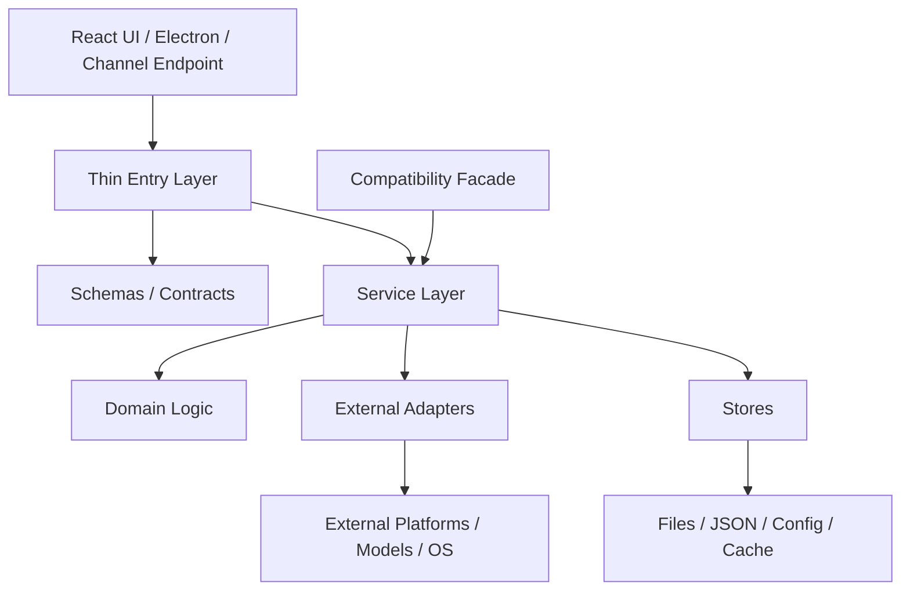

# 蓝台项目分层重构方案报告

日期：2026-05-17  
范围：基于当前仓库代码结构，对后续“像样式重构一样，把一大坨功能拆成可维护分层”的重构机会、风险、顺序、验收和回滚方案做完整规划。  
原则：本报告是重构计划，不是功能需求文档。第一目标是降低牵一发动全身的维护风险，第二目标才是代码美观。

---

## 0. 最新执行状态

截至 2026-07-27，Electron main 进程拆分已完成第三阶段，项目已切换为单一官网发行线：

- `main.cjs` 已收敛为启动编排层，直接业务职责移出。
- 后端生命周期、窗口、托盘、通用 IPC、安全 header、窗口状态已经分模块管理；桌面自动更新模块已移除。
- `lantai3` 是唯一维护中的产品目录，负责官网、GitHub Release 和 Developer ID 分发；`lantai_App Store` 仅保留为历史归档，不再同步、构建、测试、签名或发布。
- 会员中心、兑换码和 IAP 购买链已退出当前产品主线。
- 后续再动 Electron 主进程时，以 `docs/electron-main-architecture-zh.md` 为准。

当前重构和发布均以官网版为唯一目标；不再维护双目录同步或渠道 Adapter。历史报告中涉及 MAS/TestFlight 的记录仅用于解释当时的决策与验证，不构成当前工作项。

---

## 1. 执行摘要

当前项目里已经有不少功能完成度很高，但多个核心模块存在同一种结构问题：

- 单个文件同时承担入口、业务规则、外部平台适配、数据读写、错误兼容、状态管理。
- 修改一个局部行为时，必须进入一个超大文件，并理解多个无关领域。
- 真实变化原因没有分层：例如“平台 API 变了”“UI 表单变了”“配置字段变了”“模型 payload 变了”现在容易互相影响。
- 测试边界不够清晰，很多行为只能通过人工端到端试出来。

这次全局样式拆分的经验可以复用，但功能重构比样式重构风险高得多。功能重构不能追求“一次大拆完”，应该采用：

1. 先锁定行为。
2. 再只搬家，不改行为。
3. 保留兼容 facade。
4. 每次只拆一个变化轴。
5. 每个阶段都有构建、测试、手工验收和回滚点。

推荐执行顺序：

1. 页面级 Less 分层。
2. ChannelDrawer 前端表单分层。
3. Electron main 进程拆分。
4. Workspace / Wiki / Memory router 服务化。
5. Config schema / io / migrations 分层。
6. Local Model 状态管理分层。
7. Skills 系统分层。
8. Chat 前端分层。
9. Provider / Model 管线分层。
10. Channel 后端系统分层。
11. Agent Runtime / Memory / Context 分层。

其中 1-4 是第一轮建议实际启动的范围；9-11 是高风险模块，必须等 contract tests 和回归样例足够后再动。

---

## 2. 本次重构的目标与非目标

### 2.1 目标

本次重构追求以下目标：

- 降低单文件复杂度。
- 让不同变化原因有自己的局部层。
- 新增渠道、新增 provider、新增技能、新增配置项时，不需要碰主流程大文件。
- 让测试可以打到更小的单元。
- 给后续功能扩展准备稳定边界。
- 让前端页面、后端服务、外部适配器之间职责更清楚。

### 2.2 非目标

第一阶段不建议做这些事：

- 不重写业务行为。
- 不修改 API 路径和响应结构。
- 不重新设计配置文件格式。
- 不删除旧 import 路径。
- 不统一大范围命名。
- 不顺手清理所有历史兼容逻辑。
- 不在同一个 PR / commit 里同时动 Provider、Channel、Agent Runtime。

这些事不是不做，而是应该放到分层稳定之后的第二轮。

---

## 3. 推荐的目标架构思想

重构时不要按“文件大小”机械切，而要按“变化原因”切。

推荐统一采用下面这组层：

```text
入口层 Entry
  API router / Electron IPC / React page / Channel webhook endpoint

Schema / Contract 层
  Pydantic schema / TypeScript type / domain dataclass / event contract

领域服务层 Service
  业务用例编排，例如导入 workspace、保存 channel config、发送 chat message

领域逻辑层 Domain
  纯规则、纯转换、纯校验，例如 wiki lint、payload normalize、skill conflict resolve

适配器层 Adapter
  外部系统差异，例如 DingTalk、Feishu、OpenAI-compatible、Member Gateway

存储层 Store
  文件、JSON、manifest、config、local cache、session store

兼容门面 Facade
  保留旧 import 和旧调用方式，逐步迁移内部实现
```

可以用一张逻辑图理解：



### 3.1 一个模块拆完后的理想状态

一个模块拆完之后，应该满足：

- 入口文件变薄，只负责接参数、调用 service、返回结果。
- service 可以读懂主要业务流程。
- domain 函数尽量纯，能单测。
- adapter 文件只处理外部平台差异。
- store 文件只处理持久化，不塞业务判断。
- 旧路径仍可 import，避免一次性破坏全项目。

---

## 4. 风险评分方法

本报告按 5 个维度评估风险，每项 1-5 分。

| 维度 | 1 分 | 3 分 | 5 分 |
|---|---|---|---|
| 业务影响 | 只影响视觉或局部 UI | 影响普通功能流 | 影响核心对话、模型、渠道、记忆 |
| 耦合程度 | 少量依赖 | 多处调用 | 横跨前后端/外部系统/异步状态 |
| 状态复杂度 | 基本无状态 | 有本地状态或缓存 | 有持久化、迁移、队列、stream |
| 外部依赖 | 无外部依赖 | 依赖浏览器/桌面环境 | 依赖第三方平台、模型 API、webhook |
| 可测试性 | 易单测 | 需要集成测试 | 需要 fixture replay 或人工端到端 |

风险等级：

- 5-8：低风险。
- 9-13：中低风险。
- 14-17：中风险。
- 18-21：中高风险。
- 22-25：高风险。

---

## 5. 总体风险矩阵

| 模块 | 主要文件 | 风险等级 | 分数 | 推荐顺序 | 主要风险 |
|---|---|---:|---:|---:|---|
| 页面级 Less 分层 | `console/src/pages/**/index.module.less` | 低 | 6 | 1 | 视觉回归、class 名遗漏 |
| ChannelDrawer 前端 | `console/src/pages/Control/Channels/components/ChannelDrawer.tsx` | 中低 | 11 | 2 | 表单保存 payload 变化 |
| Electron main 进程 | `console/electron/main.cjs` | 中 | 15 | 3 | 桌面启动、IPC、更新、后端进程 |
| Workspace / Wiki / Memory router | `src/lantai/app/routers/workspace.py` | 中 | 16 | 4 | API response、文件读写、zip、wiki 解析 |
| Local Model | LocalModel modal | 中 | 16 | 5 | 状态轮询、数据规范化、本地服务状态 |
| Config 系统 | `src/lantai/config/config.py` | 中高 | 19 | 6 | 配置丢字段、默认值变化、迁移失败 |
| Skills 系统 | `src/lantai/agents/skills_manager.py`、`routers/skills.py` | 中高 | 20 | 7 | 技能导入、manifest、同步、环境变量 |
| Chat 前端 | `console/src/pages/Chat/index.tsx` | 中高 | 20 | 8 | 发消息、附件、技能调用、stream UI |
| Provider / Model 管线 | `providers/provider_manager.py`、`agents/model_factory.py` | 高 | 23 | 9 | 模型 payload、stream、tool result、多模态 |
| Channel 后端 | `src/lantai/app/channels/*/channel.py` | 高 | 24 | 10 | webhook、异步生命周期、平台 API、媒体 |
| Runtime Kernel / Memory / Context | `runtime/**`、`runner.py`、`legacy_lantai_agent.py`、`memory/*`、`context/*` | 最高 | 25 | 11 | agent 行为、记忆、压缩、工具调用 |

---

## 6. 全局安全策略

### 6.1 行为锁定优先

每个模块开拆前，先补至少一种行为锁：

- API 模块：OpenAPI diff 或 response snapshot。
- Config 模块：load-save-load round-trip。
- Provider 模块：request payload snapshot。
- Channel 模块：webhook fixture replay。
- Chat 模块：React 测试覆盖核心交互。
- Electron 模块：启动、IPC、后端进程 smoke。

### 6.2 Facade 保留策略

大文件拆分后，旧文件不要立刻删空。建议保留 facade：

```python
# old_module.py
from .new_module import OldPublicClass, old_public_function

__all__ = ["OldPublicClass", "old_public_function"]
```

这样可以降低全项目 import 迁移风险。

### 6.3 提交粒度

推荐一个模块一个分支，一个步骤一个 commit。

示例：

```text
refactor/workspace-schemas
refactor/workspace-wiki-domain
refactor/workspace-router-split
```

每个 commit 应该能单独构建，不能把“搬文件”和“改行为”混在一起。

### 6.4 回滚策略

每个模块必须具备回滚点：

- 只要测试不过，回滚当前 commit，不回滚前一阶段。
- 高风险模块必须保留旧实现路径到本阶段完成。
- 外部适配类模块可以用 feature flag 或环境变量切新路径。
- 涉及配置、skills、workspace 文件的操作，先备份用户目录样例。

### 6.5 不碰用户已有改动

当前工作树已有大量修改。实施时需要遵守：

- 先确认本次要动的文件清单。
- 不顺手格式化全仓。
- 不回滚 unrelated changes。
- 只在本模块目录内操作。

---

## 7. 阶段 0：基线与行为锁定

### 7.1 目标

在任何功能拆分之前，建立可以判断“行为没变”的基线。

### 7.2 要做的事

#### 后端基线

建议执行：

```bash
pytest tests/unit
pytest tests/contract
```

如果全量太慢，可以按模块先跑：

```bash
pytest tests/unit/config
pytest tests/unit/workspace
pytest tests/unit/providers
pytest tests/unit/channels
pytest tests/contract/providers
pytest tests/contract/channels
```

#### 前端基线

建议执行：

```bash
cd console
npm run build
npm run test:run
```

#### Electron 基线

建议至少验证：

```bash
cd console
npm run build
npm run electron:preview
```

#### API 基线

建议补一个脚本或测试，记录关键 API：

- workspace files。
- wiki list/detail/lint/insights。
- skills list/import/delete。
- providers list/active model。
- channels list/save/test。
- provider status。

### 7.3 产物

阶段 0 结束后应该有：

- 一份当前可通过的测试命令清单。
- 一组高风险模块 fixture。
- 一份允许失败的已知 warning 列表。
- 一份重构期间不允许变化的 API contract 列表。

### 7.4 验收标准

- 可以明确说出当前有哪些测试是绿的。
- 可以明确说出哪些 warning 是既有问题。
- 后续每个模块重构后都能用同一组命令验证。

---

## 8. 阶段 1：低风险结构拆分

阶段 1 的目标是拿到架构收益，同时尽量不碰核心功能链路。

---

## 8.1 页面级 Less 分层

### 当前问题

全局样式已经完成分层，但多个页面级 Less 仍然很大，例如：

- `console/src/pages/Settings/Models/index.module.less`
- `console/src/pages/Agent/Skills/index.module.less`
- `console/src/pages/Agent/Workspace/index.module.less`
- `console/src/pages/Settings/SkillPool/index.module.less`
- `console/src/pages/Chat/index.module.less`

这些文件常见问题：

- 布局、卡片、toolbar、状态、drawer 混在一个文件。
- 后续微调一个区块时容易误改旁边规则。
- class 名缺少结构边界。

### 风险

风险等级：低。  
主要风险：视觉回归、class 名漏迁移、CSS module import 问题。

### 目标结构

以 `Settings/Models` 为例：

```text
console/src/pages/Settings/Models/styles/
  index.module.less
  layout.module.less
  toolbar.module.less
  provider-card.module.less
  local-runtime.module.less
  modal.module.less
  states.module.less
```

如果不想一次修改 TS import，也可以先保留：

```text
index.module.less
styles/
  layout.less
  cards.less
  modal.less
```

然后由 `index.module.less` 统一 `@import`。

### 实施步骤

1. 选一个页面试点，建议 `Settings/Models`。
2. 标记原 Less 的区块边界。
3. 按 layout / toolbar / card / modal / state 拆文件。
4. 保持 class 名不变。
5. 保持 TS import 不变。
6. 跑前端 build。
7. 用浏览器检查对应页面。
8. 再迁移其他大页面。

### 验收标准

- `npm run build` 通过。
- 目标页面 class 名不变。
- 页面主布局、弹窗、按钮、响应式无明显回归。
- Git diff 主要是样式文件搬迁，不夹杂 TS 逻辑变更。

### 回滚方式

回滚当前页面的 Less commit 即可。因为没有改 TS 逻辑，回滚成本低。

---

## 8.2 ChannelDrawer 前端分层

### 当前问题

文件：

```text
console/src/pages/Control/Channels/components/ChannelDrawer.tsx
```

这个组件承担了：

- 所有 channel 的字段定义。
- 所有 channel 的条件显示。
- 表单初始值转换。
- 保存 payload 组装。
- access control 配置。
- webhook / token / bot / voice 等 UI 区块。

问题是新增或修改一个 channel 时，需要进入同一个大组件，容易误伤其他渠道。

### 风险

风险等级：中低。  
主要风险：

- 某个渠道字段漏显示。
- 默认值变化。
- 保存 payload 字段变化。
- 表单校验逻辑变化。

### 目标结构

```text
console/src/pages/Control/Channels/components/ChannelDrawer/
  index.tsx
  channelSchema.ts
  channelDefaults.ts
  useChannelForm.ts
  sections/
    BasicSection.tsx
    AccessControlSection.tsx
    WebhookSection.tsx
    BotCredentialSection.tsx
    VoiceSection.tsx
    AdvancedSection.tsx
  fields/
    ChannelTextField.tsx
    ChannelSwitchField.tsx
    ChannelSecretField.tsx
```

### 分层职责

| 层 | 职责 |
|---|---|
| `index.tsx` | Drawer 外壳、打开关闭、组合 section |
| `channelSchema.ts` | 每个 channel 有哪些字段、label、placeholder、是否 secret |
| `channelDefaults.ts` | 默认值和旧配置归一化 |
| `useChannelForm.ts` | 表单状态、校验、保存 payload |
| `sections/*` | UI 区块 |
| `fields/*` | 复用输入控件 |

### 实施步骤

1. 先抽常量：`CHANNELS_WITH_ACCESS_CONTROL`、基础字段、渠道字段。
2. 抽 `channelSchema.ts`，不改 UI。
3. 抽 `useChannelForm.ts`，保存 payload 先保持完全一致。
4. 抽 `AccessControlSection`。
5. 抽 `BasicSection`。
6. 抽每类 bot/webhook/voice section。
7. 最后把 `ChannelDrawer.tsx` 改成薄组合层。

### 验收标准

- 每个渠道打开 drawer 不报错。
- 每个渠道字段数量一致。
- 保存请求 payload 与重构前一致。
- 新建、编辑、禁用、access control 设置都可用。
- 前端 build 和相关测试通过。

### 推荐测试

- 给 `channelSchema.ts` 加单测：每个 channel 至少有 `enabled`、基础标识字段。
- 给 `useChannelForm.ts` 加 payload snapshot。
- 手工检查 DingTalk、Feishu、WeCom、Telegram、Matrix、QQ、Console 等主要渠道。

### 回滚方式

因为抽出来的 section 都只服务 Drawer，回滚 `ChannelDrawer` 整个目录即可。

---

## 8.3 Electron main 进程拆分

### 当前问题

文件：

```text
console/electron/main.cjs
```

目前集中承担：

- 应用窗口创建。
- 窗口状态保存。
- 后端进程启动和重启。
- loopback 端口检测。
- API header 注入。
- IPC 注册。
- tray。

任何桌面行为调整都需要进入同一个 main 文件。

### 风险

风险等级：中。  
主要风险：

- 应用打不开。
- 后端进程没启动。
- IPC channel 丢失。
- 打包路径变化。

### 目标结构

```text
console/electron/
  main.cjs
  appWindow.cjs
  backendProcess.cjs
  backendLifecycleController.cjs
  ipc.cjs
  tray.cjs
  windowState.cjs
  securityHeaders.cjs
  paths.cjs
  logger.cjs
```

### 分层职责

| 文件 | 职责 |
|---|---|
| `main.cjs` | app 生命周期和模块组合 |
| `appWindow.cjs` | BrowserWindow 创建、加载 URL、窗口事件 |
| `backendProcess.cjs` | 后端启动计划、URL、鉴权 header、端口和重启策略等纯工具 |
| `backendLifecycleController.cjs` | 后端子进程启动、停止、健康检查、重启 timer 和日志绑定 |
| `ipc.cjs` | IPC handlers 注册 |
| `tray.cjs` | tray 菜单 |
| `windowState.cjs` | 窗口位置、尺寸持久化 |
| `securityHeaders.cjs` | 请求 header 和安全相关处理 |
| `paths.cjs` | dev/prod 路径判断 |

### 实施步骤

1. 抽纯路径逻辑到 `paths.cjs`。
2. 抽窗口状态到 `windowState.cjs`。
3. 抽后端启动纯工具到 `backendProcess.cjs`。
4. 抽后端生命周期控制器到 `backendLifecycleController.cjs`。
5. 抽 IPC 到 `ipc.cjs`。
6. 抽 tray。
7. 保持 `main.cjs` 只做生命周期编排。
8. 保持自动更新能力缺席，仅允许只读本地版本号。

### 验收标准

- `npm run build` 通过。
- `npm run electron:preview` 能启动。
- 后端服务能自动起来。
- 关闭应用后后端进程被正确处理。
- IPC 功能正常。
- 更新相关日志没有异常。

### 回滚方式

保留原 `main.cjs` 的 commit 边界；若启动失败，回滚 Electron 阶段即可，不影响后端和前端业务代码。

---

## 9. 阶段 2：中风险服务层拆分

阶段 2 开始涉及 API、配置和文件读写。这里必须以测试和兼容 facade 为前提。

---

## 9.1 Workspace / Wiki / Memory router 服务化

### 当前问题

文件：

```text
src/lantai/app/routers/workspace.py
```

这个文件混合了：

- API schema。
- workspace 文件列表。
- wiki root / source 处理。
- markdown frontmatter 解析。
- wiki graph。
- wiki lint。
- wiki insights。
- zip 导入导出。
- 用户记忆。
- 语言、音频、transcription 相关设置。

这类代码后续最容易变成“新功能都往 workspace.py 里加”。

### 风险

风险等级：中。  
主要风险：

- API 路径变化。
- response shape 变化。
- wiki 文件解析不一致。
- zip 导入导出漏文件。
- memory 增删改查行为变化。
- workspace 路径安全边界变化。

### 目标结构

```text
src/lantai/app/routers/
  workspace.py
  workspace_files.py
  wiki.py
  workspace_memory.py
  workspace_archive.py
  workspace_settings.py

src/lantai/workspace/
  __init__.py
  schemas.py
  paths.py
  files_service.py
  archive_service.py
  wiki/
    __init__.py
    parser.py
    store.py
    graph.py
    lint.py
    insights.py
    sources.py
  memory_service.py
  settings_service.py
```

### 分层职责

| 层 | 职责 |
|---|---|
| routers | FastAPI endpoint，参数校验，调用 service |
| schemas | Pydantic request / response |
| paths | workspace root、安全路径、agent workspace |
| files_service | 文件列表、读取、写入、删除 |
| archive_service | zip 导入导出、校验 |
| wiki/parser | frontmatter、markdown 结构 |
| wiki/store | wiki 文件读写 |
| wiki/graph | 链接、关系图 |
| wiki/lint | lint 规则 |
| wiki/insights | 汇总、统计、建议 |
| memory_service | 用户记忆 CRUD |
| settings_service | workspace 相关设置 |

### 实施步骤

#### Step 1：抽 schema

- 新建 `src/lantai/workspace/schemas.py`。
- 移动 Pydantic 模型。
- `workspace.py` 从新位置 import。
- 不改任何字段名。

验收：

```bash
pytest tests/unit/workspace tests/unit/routers
```

#### Step 2：抽 wiki parser

- 移动 `_extract_frontmatter` 等纯解析逻辑。
- 给 parser 加单测。
- 准备 markdown fixture：有 frontmatter、无 frontmatter、坏 frontmatter、中文标题、链接。

验收：

```bash
pytest tests/unit/workspace
```

#### Step 3：抽 wiki lint / graph / insights

- lint 规则单独成模块。
- graph 只处理链接关系。
- insights 只处理统计和建议。

验收：

- 相同 wiki fixture 输出一致。
- lint issue 数量和内容一致。

#### Step 4：抽 files_service / archive_service

- 文件操作统一过 `paths.py`。
- zip 校验保留原行为。
- 危险路径测试必须保留。

验收：

- 文件列表一致。
- zip 导出内容一致。
- zip 导入后文件树一致。

#### Step 5：拆 router

- `workspace.py` 保留 include_router 或兼容入口。
- 新 endpoint 文件按主题拆。
- URL 不变。

验收：

- OpenAPI 路径不变。
- 前端 workspace 页面正常。

### 推荐测试

- `tests/unit/workspace/test_wiki_parser.py`
- `tests/unit/workspace/test_wiki_lint.py`
- `tests/unit/workspace/test_archive_service.py`
- `tests/unit/routers/test_workspace_api_shape.py`

### 回滚方式

每个 step 单独 commit。若 router 拆分失败，可以保留 service 抽取，但回滚 router split。

---

## 9.2 Config 系统分层

### 当前问题

文件：

```text
src/lantai/config/config.py
```

当前混合了：

- 所有配置 schema。
- 默认值。
- channel config。
- agent config。
- memory config。
- tools/security/mcp config。
- load/save。
- legacy migration。
- workspace migration。
- provider config。

配置系统是中高风险，因为一旦字段丢失，用户配置可能不可逆损坏。

### 风险

风险等级：中高。  
主要风险：

- 旧配置无法加载。
- 保存后字段丢失。
- 默认值变化。
- migration 顺序变化。
- 某个模块旧 import 失败。

### 目标结构

```text
src/lantai/config/
  __init__.py
  config.py
  io.py
  defaults.py
  selectors.py
  migrations/
    __init__.py
    legacy.py
    channels.py
    workspace.py
    agents.py
  schema/
    __init__.py
    root.py
    channels.py
    agents.py
    memory.py
    providers.py
    tools.py
    security.py
    mcp.py
    local_models.py
```

### 兼容策略

`config.py` 第一阶段不删除，改成 facade：

```python
from .schema.root import Config
from .schema.channels import ChannelConfig
from .io import load_config, save_config

__all__ = ["Config", "ChannelConfig", "load_config", "save_config"]
```

### 实施步骤

#### Step 1：建立 schema 包

- 只移动 Pydantic class。
- 原 public class 从 `config.py` re-export。
- 不改字段、不改默认值。

#### Step 2：抽 defaults

- 所有默认 provider/channel/agent 配置进入 `defaults.py` 或 `defaults/`。
- 默认值测试用 snapshot。

#### Step 3：抽 io

- load/save/atomic write 进入 `io.py`。
- 保留原函数名。

#### Step 4：抽 migrations

- legacy 迁移按主题拆。
- 每个 migration 必须有输入输出 fixture。

#### Step 5：抽 selectors

- 常用读取逻辑，例如当前 agent、当前 channel、active model。
- selectors 只读，不写。

### 必须补的测试

- 空配置加载。
- 老配置加载。
- 带未知字段配置加载。
- load-save-load round-trip。
- migration fixture。
- agent/channel/provider 默认值 snapshot。

推荐命令：

```bash
pytest tests/unit/config
pytest tests/unit/routers/test_config_channels.py
```

### 验收标准

- 旧 import 路径不破。
- 配置保存前后无字段丢失。
- 默认配置生成结果一致。
- app 能正常启动。

### 回滚方式

因为配置风险高，每个 step 必须能单独回滚。不能在同一步里既拆 schema 又改 migration。

---

## 9.3 Local Model 分层

### 当前问题

相关文件：

```text
console/src/pages/Settings/Models/components/modals/LocalModelManageModal.tsx
src/lantai/local_models/*
```

会员中心相关 API 和后端模块已经从当前产品主线移除。Local Model modal 仍混合了：

- modal UI。
- 本地模型配置。
- 下载状态。
- server 状态。
- polling。
- 保存。
- 错误提示。

### 风险

风险等级：中。  
主要风险：

- 模型可用性判断变化。
- polling 泄漏。
- 本地模型 server 状态错判。

### 目标结构

Local Model UI：

```text
console/src/pages/Settings/Models/components/modals/LocalModelManageModal/
  index.tsx
  useLocalModelConfig.ts
  useLocalModelServer.ts
  useLocalModelDownload.ts
  sections/
    RuntimeSection.tsx
    DownloadSection.tsx
    ModelListSection.tsx
    AdvancedSection.tsx
```

后端：

```text
src/lantai/local_models/
  runtime.py
  download.py
  config.py
  provider_bridge.py
```

### 实施步骤

1. LocalModel modal 先抽 hooks，不改 UI。
2. 抽 sections。
3. 后端 local model runtime/download/config 分层。

### 验收标准

- 本地模型下载状态、server 状态、启动/停止按钮行为一致。
- polling 在关闭 modal 后停止。

---

## 10. 阶段 3：中高风险业务系统拆分

---

## 10.1 Skills 系统分层

### 当前问题

相关文件：

```text
src/lantai/agents/skills_manager.py
src/lantai/app/routers/skills.py
console/src/pages/Settings/SkillPool/useSkillPool.tsx
console/src/pages/Agent/Skills/index.tsx
```

当前 Skills 系统混合了：

- 内置技能发现。
- 语言变体选择。
- 文件系统扫描。
- `SKILL.md` frontmatter。
- manifest JSON。
- lock。
- zip 导入。
- 冲突检测。
- env overrides。
- 技能池同步。
- router API。
- 前端导入/同步/过滤/展示状态。

### 风险

风险等级：中高。  
主要风险：

- 用户技能丢失。
- manifest 写坏。
- 内置技能显示不完整。
- 导入冲突处理变化。
- env override 不生效。
- 技能同步误判。

### 目标结构

后端：

```text
src/lantai/skills/
  __init__.py
  models.py
  registry.py
  builtin_registry.py
  language_variants.py
  manifest_store.py
  filesystem.py
  importer.py
  validator.py
  conflicts.py
  env_overrides.py
  sync.py
  services.py
```

router：

```text
src/lantai/app/routers/skills.py
```

前端：

```text
console/src/pages/Settings/SkillPool/
  useSkillPoolData.ts
  useSkillPoolImport.ts
  useSkillPoolSync.ts
  useSkillPoolFilters.ts
  components/
```

### 分层职责

| 模块 | 职责 |
|---|---|
| `registry.py` | 用户技能扫描、路径归一化 |
| `builtin_registry.py` | 内置技能发现 |
| `language_variants.py` | zh/en/qa/local 变体选择 |
| `manifest_store.py` | manifest 读写、锁 |
| `importer.py` | zip/dir 导入 |
| `validator.py` | SKILL.md 合法性、路径安全 |
| `conflicts.py` | 冲突检测和 rename |
| `env_overrides.py` | 环境变量覆盖 |
| `sync.py` | 内置技能同步状态 |
| `services.py` | 用例编排 |

### 实施步骤

#### Step 1：manifest store

- 抽 JSON 读写。
- 抽 lock。
- 加 round-trip 测试。

#### Step 2：builtin registry

- 抽内置技能路径和语言变体。
- 固定 fixture。
- 确保当前内置技能数量不变。

#### Step 3：importer / validator

- 抽 zip 验证。
- 抽路径安全检查。
- 抽冲突检测。

#### Step 4：env overrides

- 单独测试启用、禁用、覆盖、删除。

#### Step 5：router 服务化

- router 只负责 request/response。
- 所有业务调用 `SkillService`。

#### Step 6：前端 useSkillPool 拆分

- 先抽 data hook。
- 再抽 import hook。
- 再抽 sync hook。
- 最后抽 filter hook。

### 推荐测试

```bash
pytest tests/unit/agents/test_skills_manager_builtin_import.py
pytest tests/unit/routers
cd console && npm run test:run
```

需要新增：

- `test_skill_manifest_store.py`
- `test_skill_importer.py`
- `test_skill_conflicts.py`
- `test_skill_env_overrides.py`

### 验收标准

- 内置技能数量一致。
- 用户技能列表一致。
- 导入 zip 行为一致。
- 冲突 rename 行为一致。
- env override 生效。
- 前端 SkillPool 操作正常。

### 回滚方式

先保留 `skills_manager.py` 作为 facade。新 `src/lantai/skills/*` 可逐步接管，不要一次替换全部调用点。

---

## 10.2 Chat 前端分层

### 当前问题

文件：

```text
console/src/pages/Chat/index.tsx
console/src/pages/Chat/sessionApi/index.ts
```

Chat 页面现在承担：

- 页面布局。
- 消息发送。
- 消息 payload normalize。
- slash command。
- history clear payload。
- skill invocation 注入。
- multimodal capability。
- drag/drop attachment。
- IME composition。
- message history navigation。
- runtime loading bridge。
- 澜台本地 chat shim、runtime event stream 和工具卡片适配。

这是用户最常用页面之一，风险高于普通设置页。

### 风险

风险等级：中高。  
主要风险：

- 普通消息发不出。
- 附件消息 payload 变化。
- slash command 行为变化。
- 技能调用插入逻辑变化。
- stream loading 状态变化。
- 历史导航失效。
- IME 中文输入异常。

### 目标结构

```text
console/src/pages/Chat/
  index.tsx
  ChatPage.tsx
  domain/
    commands.ts
    messageNormalize.ts
    skillInvocation.ts
    attachments.ts
    historyPayloads.ts
  hooks/
    useIMEComposition.ts
    useMultimodalCapabilities.ts
    useMessageHistoryNavigation.ts
    useChatDragDrop.ts
    useChatSubmit.ts
  adapters/
    runtimeStream.tsx
    toolRenderers.tsx
  sessionApi/
    index.ts
    sessions.ts
    messages.ts
    metadata.ts
```

### 实施步骤

#### Step 1：抽纯函数

先抽这些最安全：

- history clear payload。
- message normalize。
- command parse。
- skill invocation payload。
- attachment helpers。

这些函数应该全部有单测。

#### Step 2：抽 hooks

依次抽：

- `useIMEComposition`
- `useMultimodalCapabilities`
- `useMessageHistoryNavigation`
- `useChatDragDrop`

抽 hook 时不改 UI。

#### Step 3：抽 adapters

- runtime stream / response card 相关包装进入 `adapters/runtimeStream.tsx`。
- tool renderer 进入 `adapters/toolRenderers.tsx`。

#### Step 4：拆 sessionApi

- session list。
- message list。
- metadata。
- history clear。

保持 `sessionApi/index.ts` re-export。

### 推荐测试

现有：

```text
console/src/pages/Chat/ChatPage.test.tsx
console/src/pages/Chat/utils.test.ts
```

建议新增：

- `domain/messageNormalize.test.ts`
- `domain/commands.test.ts`
- `domain/skillInvocation.test.ts`
- `hooks/useMessageHistoryNavigation.test.tsx`

运行：

```bash
cd console
npm run test:run
npm run build
```

### 手工验收清单

- 发送普通文本。
- 发送中文输入法文本。
- 发送带附件消息。
- 使用 slash command。
- 触发技能选择。
- 上下键历史导航。
- 清空历史。
- 切换模型。
- stream loading 正常消失。

### 回滚方式

Chat 抽取必须分小 commit。若抽 hooks 后行为异常，可只回滚 hook commit，保留纯函数抽取。

---

## 11. 阶段 4：高风险外部适配层拆分

这个阶段不建议在没有 fixture 和 contract tests 的情况下启动。

---

## 11.1 Provider / Model 管线分层

### 当前问题

相关文件：

```text
src/lantai/providers/provider_manager.py
src/lantai/providers/openai_provider.py
src/lantai/providers/openai_chat_model_compat.py
src/lantai/agents/model_factory.py
```

当前混合了：

- built-in provider catalog。
- 默认模型列表。
- 自定义 provider。
- active model。
- provider 持久化。
- 本地模型恢复。
- capability probing。
- OpenAI-compatible 兼容。
- media block 格式化。
- tool result 格式化。
- stream 兼容。
- formatter monkey patch。

这部分是模型调用核心链路，风险高。

### 风险

风险等级：高。  
主要风险：

- 请求 payload 变化导致模型失败。
- tool call / tool result 格式不兼容。
- stream chunk 解析变化。
- 多模态图片/视频 block 变化。
- provider active model 丢失。
- 本地模型 fallback 变化。
- 用户自定义 Provider 行为变化。

### 目标结构

```text
src/lantai/providers/
  catalog.py
  models.py
  registry.py
  storage.py
  activation.py
  custom_providers.py
  local_resume.py
  probing/
    __init__.py
    baseline.py
    image.py
    video.py
    reasoning.py
  compat/
    __init__.py
    openai_messages.py
    openai_stream.py
    tool_results.py
    media_blocks.py

src/lantai/agents/model_pipeline/
  __init__.py
  factory.py
  formatter_selector.py
  media_transform.py
  request_normalizer.py
  tool_result_transform.py
```

### 实施步骤

#### Step 1：抽 catalog

- 把 built-in provider definitions 移到 `catalog.py`。
- ProviderManager 从 catalog 加载。
- 不改 provider id、model id。

测试：

- provider list snapshot。
- 默认 active model 一致。

#### Step 2：抽 storage

- 自定义 provider 读写进入 `storage.py`。
- 加 round-trip 测试。

#### Step 3：抽 activation

- active provider / active model 选择逻辑进入 `activation.py`。
- 处理旧配置和缺省 fallback。

#### Step 4：抽 probing

- 能力探测进入 `probing/`。
- image/video/reasoning baseline 分开。

#### Step 5：抽 compat

- OpenAI-compatible message transform。
- stream transform。
- tool result transform。
- media block transform。

#### Step 6：抽 model_pipeline

- `model_factory.py` 保留 facade。
- 新建 factory、formatter_selector、media_transform。

### 必须补的 contract tests

- OpenAI-compatible 文本请求 payload。
- OpenAI-compatible 图片请求 payload。
- tool call 请求 payload。
- tool result 请求 payload。
- stream chunk normalization。
- 自定义 Provider request/response。
- 本地模型 provider 激活。

推荐命令：

```bash
pytest tests/unit/providers
pytest tests/contract/providers
```

### 验收标准

- provider list 一致。
- active model 一致。
- 文本对话可用。
- tool call 可用。
- 图片输入可用。
- stream 输出正常。
- 自定义 Provider 可用。

### 回滚方式

高风险模块建议引入临时环境变量：

```text
LANTAI_PROVIDER_PIPELINE_V2=1
```

默认仍走旧路径。V2 验证稳定后再切默认。

---

## 11.2 Channel 后端系统分层

### 当前问题

相关文件：

```text
src/lantai/app/channels/base.py
src/lantai/app/channels/dingtalk/channel.py
src/lantai/app/channels/feishu/channel.py
src/lantai/app/channels/qq/channel.py
src/lantai/app/channels/matrix/channel.py
src/lantai/app/channels/wechat/channel.py
src/lantai/app/channels/wecom/channel.py
src/lantai/app/channels/telegram/channel.py
```

每个 channel 文件普遍混合：

- 配置读取。
- 平台 client。
- token/session。
- webhook 或 websocket。
- incoming event parse。
- outgoing message send。
- media upload/download。
- group mention / allowlist。
- task tracker。
- retry / fallback。
- health / lifecycle。

`base.py` 也承载了较多跨平台职责。

### 风险

风险等级：高。  
主要风险：

- 某个平台收不到消息。
- 收到消息但 canonical message 转换错误。
- 图片/文件丢失。
- 群聊 mention 判断变化。
- send fallback 行为变化。
- 异步任务泄漏。
- webhook ack 行为变化。

### 目标结构

通用层：

```text
src/lantai/app/channels/
  contracts.py
  core/
    base.py
    queue.py
    debounce.py
    routing.py
    task_tracker.py
    allowlist.py
    render_bridge.py
    lifecycle.py
```

单个平台，以 DingTalk 为例：

```text
src/lantai/app/channels/dingtalk/
  __init__.py
  config.py
  client.py
  parser.py
  sender.py
  media.py
  cards.py
  session_store.py
  lifecycle.py
  channel.py
```

### 核心 contracts

建议定义：

```python
@dataclass
class InboundMessage:
    channel: str
    conversation_id: str
    sender_id: str
    text: str | None
    attachments: list[InboundAttachment]
    raw_event: Any

@dataclass
class OutboundMessage:
    conversation_id: str
    text: str | None
    attachments: list[OutboundAttachment]
    metadata: dict[str, Any]
```

目标是把“平台事件”转换成“内部消息”这一步明确锁住。

### 实施顺序

#### Step 1：建立 contracts

- 先不改任何 channel。
- 给 contracts 加单测。
- 给现有 channel 写 adapter snapshot。

#### Step 2：选择试点 channel

不要第一步拆 DingTalk。DingTalk 卡片、stream、media、fallback 太复杂。建议先选一个中等复杂度平台，比如 Telegram 或 Mattermost。

#### Step 3：抽 parser

- raw event -> InboundMessage。
- 用 fixture replay 验证。

#### Step 4：抽 sender

- OutboundMessage -> 平台发送 API。
- 先 mock client。

#### Step 5：抽 media

- 上传、下载、mime、临时文件。
- 单独测试。

#### Step 6：抽 lifecycle / client

- websocket/polling/start/stop。
- 保持 channel.py thin orchestration。

#### Step 7：批量迁移复杂平台

顺序建议：

1. Telegram / Mattermost 试点。
2. WeCom / WeChat。
3. Feishu / Matrix。
4. QQ。
5. DingTalk 最后。

### 必须补的测试

```text
tests/fixtures/channels/
  dingtalk/
  feishu/
  telegram/
  matrix/

tests/contract/channels/
  test_inbound_contract.py
  test_outbound_contract.py
```

推荐命令：

```bash
pytest tests/unit/channels
pytest tests/contract/channels
```

### 手工验收清单

每个平台至少验：

- 私聊文本。
- 群聊文本。
- mention 判断。
- 图片。
- 文件。
- 长文本。
- 错误 fallback。
- 重启后 session 恢复。

### 回滚方式

高风险，建议每个平台独立迁移。不能把多个 channel 放在同一个 commit 里。

---

## 12. 阶段 5：最高风险 Runtime / Memory / Context

### 当前问题

相关文件：

```text
src/lantai/runtime/adapters/native_runtime.py
src/lantai/app/runner/runner.py
src/lantai/agents/legacy_lantai_agent.py
src/lantai/agents/memory/layered_memory.py
src/lantai/agents/memory/reme_light_memory_manager.py
src/lantai/agents/context/light_context_manager.py
```

这些模块影响 agent 行为本身，包括：

- prompt 组装。
- 工具调用。
- stream event。
- content filter fallback。
- 记忆写入。
- 记忆召回。
- 上下文压缩。
- runner 事件。

这是全项目风险最高的区域。

### 风险

风险等级：最高。  
主要风险：

- agent 回答行为变化。
- 工具调用结果丢失。
- stream event 顺序变化。
- 记忆写入错位。
- 记忆召回质量下降。
- context compaction 提前或滞后。
- 异常 fallback 不触发。

### 目标结构

```text
src/lantai/agents/runtime/
  __init__.py
  events.py
  stream_normalizer.py
  tool_call_handler.py
  tool_result_handler.py
  content_filter_fallback.py
  run_state.py

src/lantai/agents/memory/
  models.py
  store.py
  retrieval.py
  writer.py
  summarizer.py
  profile.py
  policies.py
  layered_memory.py

src/lantai/agents/context/
  compaction_policy.py
  message_window.py
  token_budget.py
  transcript_builder.py
```

### 实施前提

必须先准备：

- 固定对话 fixture。
- 工具调用 fixture。
- memory write fixture。
- memory retrieval fixture。
- context compaction fixture。
- stream event snapshot。

没有这些，不建议开拆。

### 实施步骤

#### Step 1：锁定 stream events

- 记录普通回复事件序列。
- 记录工具调用事件序列。
- 记录异常 fallback 事件序列。

#### Step 2：抽 events.py

- 定义内部事件类型。
- 保持外部输出不变。

#### Step 3：抽 content_filter_fallback

- 这是相对独立的异常路径。
- 有 fixture 后可以先抽。

#### Step 4：抽 memory retrieval / writer

- retrieval 只负责召回。
- writer 只负责写入。
- summarizer 只负责摘要。

#### Step 5：抽 context compaction

- token budget。
- message window。
- compaction policy。

#### Step 6：瘦身 legacy agent loop / runner

- `legacy_lantai_agent.py` 保留兼容 loop；`runner.py` / `native_runtime.py` 承担清晰运行时编排。

### 推荐测试

```bash
pytest tests/unit/agents
pytest tests/unit/agents/memory
```

需要新增：

- `test_runtime_events.py`
- `test_stream_normalizer.py`
- `test_tool_result_handler.py`
- `test_context_compaction_policy.py`
- `test_memory_retrieval_contract.py`

### 验收标准

- 普通对话输出正常。
- 工具调用正常。
- 记忆写入正常。
- 记忆召回正常。
- 上下文压缩触发点一致。
- stream UI 不乱序。

### 回滚方式

必须每个子系统独立 commit。不要在同一阶段同时抽 memory 和 runtime stream。

---

## 13. 建议的整体里程碑

### Milestone 0：基线

范围：

- 建立测试命令清单。
- 建立高风险 fixture。
- 确认已知 warning。

完成标准：

- 有一份可重复执行的验证清单。
- 后续每个阶段都能用同一套清单验收。

### Milestone 1：低风险前端和桌面拆分

范围：

- 页面级 Less。
- ChannelDrawer。
- Electron main。

完成标准：

- 前端 build 通过。
- Electron preview 可启动。
- Channel 配置保存正常。

### Milestone 2：后端中枢服务化

范围：

- Workspace router。
- Config schema/io。
- LocalModel 局部分层。

完成标准：

- 后端 unit/contract 通过。
- 配置 round-trip 通过。
- workspace/wiki/memory smoke 通过。

### Milestone 3：业务系统分层

范围：

- Skills。
- Chat。

完成标准：

- 技能导入/同步/启停正常。
- Chat 文本、附件、技能调用、stream 正常。

### Milestone 4：外部适配层

范围：

- Providers。
- Channels。

完成标准：

- provider payload snapshot 通过。
- channel fixture replay 通过。
- 至少一个平台试点上线稳定。

### Milestone 5：Agent Runtime

范围：

- Runtime events。
- Memory。
- Context compaction。

完成标准：

- agent 行为 fixture 通过。
- stream event snapshot 通过。
- memory/context 回归通过。

---

## 14. 推荐的第一轮实际执行范围

如果现在要真的动手，我建议第一轮只做：

1. 页面级 Less 分层。
2. ChannelDrawer 分层。
3. Workspace router 服务化。
4. Config schema/io 初步拆分。

原因：

- 这四项架构收益明显。
- 风险相对可控。
- 能建立后续重构模板。
- 不直接碰模型调用、外部平台 webhook、agent runtime。

第一轮不要做：

- Provider/model pipeline。
- Channel 后端全量拆。
- Agent Runtime。

这些应该等第一轮方法论和测试基线稳定后再做。

---

## 15. 每个阶段的通用验收清单

每个阶段结束前都要检查：

- 是否保持旧 API 路径。
- 是否保持旧 import 路径或提供 facade。
- 是否没有混入功能变更。
- 是否有新增或更新测试。
- 是否跑过对应测试命令。
- 是否有手工 smoke 清单。
- 是否有明确回滚 commit。
- 是否更新了相关文档。

推荐记录格式：

```md
## 重构验收记录

模块：
提交：
变更类型：只搬家 / 轻微接口整理 / 行为变更
测试命令：
测试结果：
手工验证：
已知风险：
回滚方式：
```

---

## 16. 各模块风险与应对汇总

| 风险 | 可能出现的位置 | 应对方式 |
|---|---|---|
| API shape 变化 | Workspace、Skills、Config router | OpenAPI diff、response snapshot |
| 配置字段丢失 | Config、Channels、Providers | load-save-load、fixture、备份 |
| payload 变化 | Provider、Chat、Channel | golden snapshot |
| stream 顺序变化 | Chat、Provider、Runtime | event snapshot |
| 外部平台行为变化 | Channels | webhook fixture replay、mock client |
| UI 状态丢失 | Chat、ChannelDrawer、LocalModel | React tests、手工 smoke |
| 异步任务泄漏 | Electron、Channels、Runtime | start/stop smoke、日志检查 |
| import 破坏 | Config、Skills、Provider | facade、逐步迁移 |

---

## 17. 最小可行开工计划

如果希望尽快启动，并且控制风险，可以这样做：

### 第 1 周

- 建立测试基线。
- 拆一个页面级 Less。
- 拆 ChannelDrawer 的 schema 和 form hook。

### 第 2 周

- 拆 Workspace schema。
- 抽 wiki parser/lint。
- 补 workspace fixture tests。

### 第 3 周

- 拆 Workspace files/archive service。
- 拆 Config schema。
- 保留 config facade。

### 第 4 周

- 抽 Config io。
- 补 config round-trip/migration tests。
- 总结第一轮模板。

第一轮结束后再决定是否进入 Skills/Chat。

---

## 18. 决策建议

我的建议是：

1. 先批准“阶段 0 + 阶段 1 + Workspace”的范围。
2. 暂时不要批准 Provider、Channels、Agent Runtime 的直接重构。
3. 每个模块都要求先提交测试基线，再提交拆分。
4. 第一轮成功后，把同样模板复制到 Skills、Chat、Config。
5. 高风险模块必须采用 contract tests + feature flag。

最终目标不是让目录看起来漂亮，而是让未来修改变成：

- 改 UI 就去 UI 层。
- 改配置就去 schema/io/migration。
- 改平台就去 adapter。
- 改业务规则就去 domain/service。
- 改模型兼容就去 provider compat。
- 改 agent 行为就去 runtime/memory/context。

做到这一步，项目后续才不会继续积累“大坨功能”的维护债。
